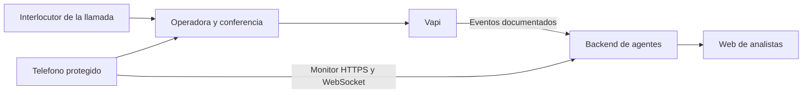

# Propuesta para investigar la IP de origen con la arquitectura actual de Tiskz

Fecha: 17 de octubre de 2026. Estado: propuesta, sin implementación ni llamadas de prueba.

## Resultado principal

La aplicación actual incorpora una conferencia telefónica: recibe una llamada en la SIM, contesta, la pone en espera, llama al número del agente y solicita unir ambas llamadas. Esto permite que Vapi participe en el audio, pero **no establece una conexión IP directa entre el dispositivo del interlocutor y el backend de Tiskz**.

Por esa razón no propongo una función que prometa «obtener la IP del estafador» con esa conferencia. Propongo un componente de servidor que reúna los identificadores de la llamada, consulte los metadatos oficiales disponibles y distinga si una dirección corresponde al usuario protegido, a un intermediario o a un extremo cuyo origen pueda corroborarse. Si el dato no llega por esa ruta, el resultado debe ser «IP de origen no disponible».

## Qué revisé y qué está confirmado

| Componente | Evidencia en los archivos | Implicación |
| --- | --- | --- |
| Conferencia Android | `TelecomConferenceRuntime.kt` solicita `answer`, `hold`, `placeCall` y `conference`; `AutomaticConference.kt` espera estados confirmados | La segunda llamada la origina la línea protegida hacia Vapi; no debe confundirse con la llamada entrante original |
| Monitor telefónico | `VoiceBackendApi.kt` solicita un ticket a `/v1/phone/monitor`; `PhoneAlertSession.kt` recibe `phone.call` con `call_id` | Hay un identificador del proveedor que puede servir para vincular la información, siempre que el backend asegure qué conferencia corresponde a ese evento |
| Agentes locales | `voice.mjs` invoca comprensión y detección sobre texto; `understanding.mjs` y `decisions.mjs` no consultan registros de red | Los modelos pueden explicar hallazgos, pero no descubrir una dirección que no esté en datos técnicos recibidos |
| IP existente en el servidor | `voice.mjs` usa `req.socket.remoteAddress` para limitar intentos al crear salas | Es la dirección del par conectado al servidor, posiblemente un proxy; no demuestra el origen del interlocutor telefónico |
| WebRTC del móvil | `WebRtcVoiceSession.kt` negocia una sesión con el proveedor de voz mediante el backend; su `getStats` actual mide energía de audio | Las estadísticas corresponden a ese enlace de voz. No describen automáticamente al interlocutor de la llamada SIM |
| Documentación Vapi del móvil | `LLAMADAS_VAPI.md` describe `/v1/phone/vapi`, autenticación y PCAP desactivado | Sirve como contrato documentado, pero falta contrastarlo con el código actualizado del backend y su configuración desplegada |

La rama remota predeterminada de `agents` y la copia local revisada no contienen `/v1/phone/vapi` ni `/v1/phone/monitor`, aunque el móvil ya los usa. El equipo confirmó que ese backend está desplegado y todavía no ha subido su código a `agents`. No modifiqué esos repositorios ni operé el despliegue. La propuesta identifica dónde integrar la funcionalidad, pero no atribuye al backend pendiente de revisión campos que no pude comprobar.

Los documentos del móvil tampoco acreditan una conferencia física completa con audio de Vapi confirmado en ambos extremos. Antes de extraer conclusiones sobre metadatos de esa ruta hay que verificar una llamada real autorizada.

## Recorrido que debemos distinguir

En ese esquema, ver una dirección del proveedor no acredita una dirección del teléfono de A. En una conferencia, el número que Vapi observa como cliente puede corresponder a la segunda llamada iniciada por B. Esta es una conclusión sobre el flujo de código; el valor concreto debe verificarse con una prueba y el proveedor.

## Propuesta de integración

### 1. Vincular las llamadas antes de buscar direcciones

Construir una relación explícita entre el incidente de la web, el identificador local de la llamada entrante, la solicitud de conferencia de Android y el `call_id` recibido del monitor de Vapi. Conservar por separado el número mostrado en Android y el número observado por Vapi.

No vincular casos solo porque llegaron al mismo número compartido o casi a la misma hora. Si no existe una asociación determinista, registrar «asociación pendiente» y pedir revisión. El documento actual limita la prueba a una llamada a la vez; eso ayuda a probar, pero no sustituye la asociación en producción.

### 2. Consultar información del proveedor desde el backend

Vapi documenta eventos con un objeto `call`, y permite consultar los registros de llamadas de la cuenta. El backend sería el lugar para revisar esa información con sus credenciales de servidor. La APK no necesita recibir la clave privada de Vapi. [Vapi: eventos del servidor](https://docs.vapi.ai/server-url/events), [Vapi: registros de llamadas](https://docs.vapi.ai/observability/logs/call-logs).

Primero comprobar qué datos entrega realmente la cuenta para una llamada de conferencia: identificador, transporte, fechas, participantes y referencias de telefonía, cuando existan. **No he confirmado un campo que entregue la IP del dispositivo que originó la primera llamada.** Un objeto genérico de metadatos o una cabecera SIP no constituyen esa garantía.

### 3. Clasificar cualquier dirección recibida

| Caso observado | Resultado que mostraría la web |
| --- | --- |
| Dirección del móvil conectado al monitor | «Conexión del usuario protegido»; no asociarla al sospechoso |
| Dirección del proxy, webhook, SBC o servidor de medios | «Infraestructura intermedia»; no ubicar al interlocutor con ella |
| Dirección recibida sin origen o participante claro | «Dirección sin atribución»; pendiente de comprobar |
| Dirección cuyo origen de extremo confirme el proveedor | «Dirección de conexión observada» con fuente, fecha y limitaciones; no identidad personal acreditada |
| Sin dirección pertinente | «IP de origen no disponible en esta ruta» |

Vapi documenta direcciones propias de sus SBC y servidores de medios. Eso explica por qué una IP presente en tráfico SIP puede pertenecer a su infraestructura. No se debe tomar una dirección de esos servidores como la del llamante. [Vapi: red SIP](https://docs.vapi.ai/advanced/sip/sip-networking).

La clasificación debe realizarla código con reglas y datos del proveedor, no el modelo completando campos por deducción. Comprensión puede redactar una explicación del resultado; detección conserva su función de alerta sobre el contenido.

### 4. Conservar solo los metadatos necesarios y autorizados

Propuesta de campos internos, aún sin implementarlos:

- Identificadores del incidente, sesión móvil, solicitud de conferencia y llamada Vapi.
- Dirección observada, si existe; fuente del dato y participante o infraestructura a que corresponde.
- Fecha y hora con zona horaria; puerto y protocolo únicamente si el proveedor los facilita.
- Estado de disponibilidad y comprobación; referencia al registro del proveedor que lo respalde.

Pueden evaluarse dentro de los metadatos actuales del incidente; no propongo otra tabla de sospechosos. El permiso de análisis no debe reutilizarse como permiso automático de conservación o entrega a terceros. No guardar tickets, códigos privados ni claves en el expediente.

### 5. Evaluar ubicación solamente después

Si existe una IP pertinente y obtenida legítimamente, GeoIP puede aportar una zona aproximada de la conexión. No acredita GPS ni domicilio; debe conservarse la precisión disponible y evitar aplicarlo a una IP que solo identifica al proveedor. [MaxMind: limitaciones de GeoIP](https://support.maxmind.com/knowledge-base/articles/maxmind-geolocation-accuracy).

## ¿Ayudaría activar PCAP?

Vapi documenta PCAP como un artefacto de diagnóstico SIP sujeto a configuración. Los documentos del móvil indican que está desactivado; no comprobé el ajuste en la cuenta desplegada. Activarlo no revela necesariamente la IP del teléfono original: la captura puede describir solamente el enlace entre proveedores o la segunda llamada. [Vapi: grabaciones, registros y PCAP](https://docs.vapi.ai/assistants/call-recording).

No lo pondría como primer paso. Antes de considerarlo, confirmar con Vapi qué extremo puede documentar en esta ruta y evaluar acceso, finalidad y conservación. No propongo habilitarlo ni capturar tráfico de terceros desde el móvil.

## Si realmente necesitan la IP del interlocutor

Hay dos rutas distintas a la conferencia actual:

1. **Servicio propio de llamada o verificación con participación informada.** El interlocutor entra voluntariamente a un cliente web, SIP o aplicación controlada por el equipo, con aviso del tratamiento de los datos. Podrían observar metadatos de esa conexión, sujetos a proxies y políticas del SDK. Esto exige cooperación y cambia el flujo; no permite localizar pasivamente a quien solo llama por la SIM. El acceso a coordenadas, además, requiere el permiso correspondiente del dispositivo. [W3C: Geolocation](https://www.w3.org/TR/geolocation/).
2. **Operador mediante una investigación autorizada.** Conservar identificadores y horarios para que las autoridades evalúen las solicitudes pertinentes sobre registros y origen. La plataforma no obtiene facultades de acceso a datos de terceros por recibir la llamada. El marco peruano sobre geolocalización de telecomunicaciones está sujeto a procedimientos y modificaciones. [MTC: Decreto Legislativo 1182 y norma relacionada](https://www.gob.pe/institucion/mtc/normas-legales/6060978-1182).

## Siguientes pasos propuestos

1. Obtener la versión actual del backend que atiende el monitor y los webhooks Vapi; localizar allí la asociación entre sesiones y `call_id`.
2. Verificar una conferencia autorizada con participantes del equipo y costos previamente confirmados. No activar funciones de captura adicionales para esta primera comprobación.
3. Revisar un registro de esa llamada en la cuenta propia de Vapi y documentar qué participante, número y transporte representa.
4. Confirmar con el proveedor si entrega una IP del extremo original, una dirección intermedia o ninguna. Dejar de investigar GeoIP del llamante si solo se tiene una dirección del proveedor.
5. Acordar conservación y acceso, y aprobar el contrato de datos con el equipo antes de implementar.
6. Probar que cambiar la red Wi-Fi/4G del usuario protegido no cambia una supuesta «IP del sospechoso». Probar también que un fallo o ausencia de datos se muestra como desconocido.
7. Presentar en la demo el resultado que realmente soporte la ruta: metadatos de origen trazables o una limitación explícita. No convertir una dirección de infraestructura en una identidad.

El resultado inmediato viable es un expediente con mejor procedencia y correlación de llamadas. La obtención de una IP del interlocutor queda condicionada a que exista acceso legítimo a un registro de su extremo; no la resuelven por sí solos los agentes de IA.
